# Praktikum 6 -- Membangun Aplikasi Manajemen Buku dengan Laravel & Filament 3.x
## 👨‍🎓 Identitas Mahasiswa

| Informasi | Keterangan |
|---|---|
| **Nama** | Muhammad Tegar Arianto |
| **NPM** | 4524210070 |
| **Mata Kuliah** | Praktikum Pemrograman Berbasis Web A |
| **Judul Praktikum** | Laravel dan Filament 3.3 |

## Deskripsi

Praktikum ini membahas pembuatan aplikasi **Sistem Manajemen Buku**
menggunakan framework Laravel dan Filament 3.x. Aplikasi menyediakan
pengelolaan data buku dan penulis dengan fitur CRUD (*Create, Read,
Update, Delete*), pencarian, filter, upload gambar sampul, serta relasi
database.

Filament digunakan untuk membangun admin panel secara lebih cepat
melalui komponen form, tabel, aksi, notifikasi, dan halaman detail yang
telah tersedia.

## Tujuan Praktikum

Setelah menyelesaikan praktikum, mahasiswa diharapkan mampu:

-   Memahami konsep MVC (*Model-View-Controller*) pada Laravel.
-   Memahami fungsi dan filosofi Filament.
-   Membuat dan mengelola database migration.
-   Membuat model serta relasi *one-to-many*.
-   Mengimplementasikan CRUD menggunakan Filament Resources.
-   Membuat form dengan validasi.
-   Mengimplementasikan upload file dan pengelolaan storage.
-   Membuat fitur pencarian dan filtering.
-   Menggunakan factory dan seeder untuk membuat data dummy.
-   Menerapkan authorization menggunakan Policies.

## Teknologi dan Kebutuhan

-   PHP \>= 8.1
-   Composer
-   Laravel
-   Filament 3.x
-   Database SQLite atau MySQL
-   Text editor/IDE, misalnya Visual Studio Code
-   Git
-   Web browser modern

## Fitur Aplikasi

  -----------------------------------------------------------------------
  Fitur                               Deskripsi
  ----------------------------------- -----------------------------------
  Manajemen penulis                   Menambah, melihat, mengubah, dan
                                      menghapus data penulis.

  Manajemen buku                      Mengelola data buku, termasuk ISBN,
                                      judul, penulis, penerbit, tahun,
                                      status, dan sampul.

  Relasi data                         Satu penulis dapat memiliki banyak
                                      buku (*one-to-many*).

  Pencarian                           Mencari data buku dan penulis
                                      melalui kolom pencarian.

  Filter                              Memfilter buku berdasarkan status,
                                      tahun, dan penulis.

  Upload sampul                       Mengunggah gambar sampul dengan
                                      format JPEG, PNG, atau WebP.

  Detail buku                         Menampilkan informasi buku melalui
                                      halaman view.

  Bulk delete                         Menghapus beberapa data sekaligus.

  Authorization                       Mengatur hak akses melalui Laravel
                                      Policies.
  -----------------------------------------------------------------------

## Instalasi dan Menjalankan Project

### 1. Membuat project Laravel

``` bash
composer create-project laravel/laravel authbook
cd authbook
```

Jalankan server untuk memastikan Laravel berjalan:

``` bash
php artisan serve
```

Buka `http://localhost:8000` pada browser.

### 2. Konfigurasi database

Untuk SQLite, buat file database:

``` bash
touch database/database.sqlite
```

Atur konfigurasi `.env`:

``` env
DB_CONNECTION=sqlite
```

Alternatif konfigurasi MySQL:

``` env
DB_CONNECTION=mysql
DB_HOST=127.0.0.1
DB_PORT=3306
DB_DATABASE=authbook
DB_USERNAME=root
DB_PASSWORD=
```

### 3. Install Filament 3

``` bash
composer require filament/filament:"^3.0"
php artisan filament:install --panels
```

Gunakan `admin` sebagai Panel ID jika diminta, atau sesuaikan dengan
kebutuhan.

### 4. Membuat model dan migration

Buat model Author dan Book beserta migration:

``` bash
php artisan make:model Author -m
php artisan make:model Book -m
```

Struktur tabel `authors`:

``` php
Schema::create('authors', function (Blueprint $table) {
    $table->id();
    $table->string('name');
    $table->timestamps();
});
```

Struktur tabel `books`:

``` php
Schema::create('books', function (Blueprint $table) {
    $table->id();
    $table->string('isbn')->unique();
    $table->string('title');
    $table->foreignId('author_id')->constrained()->onDelete('cascade');
    $table->string('publisher')->nullable();
    $table->year('year')->nullable();
    $table->string('cover')->nullable();
    $table->enum('status', ['available', 'borrowed'])->default('available');
    $table->timestamps();
});
```

### 5. Mengatur relasi model

Pada `app/Models/Author.php`, tambahkan relasi satu penulis ke banyak
buku:

``` php
public function books(): HasMany
{
    return $this->hasMany(Book::class);
}
```

Pastikan model Author menggunakan `HasFactory` dan memiliki `$fillable`
berisi `name`.

Pada `app/Models/Book.php`, tambahkan relasi buku ke penulis:

``` php
public function author(): BelongsTo
{
    return $this->belongsTo(Author::class);
}
```

Model Book menggunakan `HasFactory`, `$fillable` untuk field buku
(`isbn`, `title`, `author_id`, `publisher`, `year`, `cover`, dan
`status`), serta `$casts` untuk mengubah `year` menjadi integer.

### 6. Menjalankan migration

``` bash
php artisan migrate
php artisan migrate:status
```

Periksa bahwa tabel `authors` dan `books` telah dibuat.

### 7. Membuat factory dan seeder

Buat factory:

``` bash
php artisan make:factory AuthorFactory
php artisan make:factory BookFactory
```

Factory Author menghasilkan nama menggunakan `fake()->name()`. Factory
Book menghasilkan ISBN unik, judul, penulis, penerbit, tahun, dan status
secara acak.

Atur `database/seeders/DatabaseSeeder.php` untuk membuat data awal:

-   1 akun user dengan nama `Admin User` dan email `admin@example.com`.
-   10 data penulis.
-   50 data buku yang dibagikan secara acak ke 10 penulis.

Buat symbolic link storage dan jalankan seeder:

``` bash
php artisan storage:link
php artisan migrate:fresh --seed
```

> **Perhatian:** `migrate:fresh` menghapus seluruh tabel sebelum
> menjalankan migration kembali. Gunakan hanya pada database praktikum
> yang datanya boleh dihapus.

Verifikasi jumlah data melalui Tinker:

``` bash
php artisan tinker
```

``` php
App\Models\Author::count(); // Diharapkan 10
App\Models\Book::count();   // Diharapkan 50
```

Keluar dari Tinker dengan:

``` php
exit;
```

### 8. Membuat Filament Resources

Buat resource Author dan Book:

``` bash
php artisan make:filament-resource Author --generate
php artisan make:filament-resource Book --generate --view
```

Kustomisasi file resource yang dihasilkan:

-   `app/Filament/Resources/AuthorResource.php`
-   `app/Filament/Resources/BookResource.php`

**AuthorResource** menyediakan form nama penulis dan tabel berisi ID,
nama, jumlah buku, serta waktu pembuatan. Tabel mendukung pencarian,
sorting, edit, delete, dan bulk delete.

**BookResource** menyediakan form ISBN, judul, penulis, penerbit, tahun,
status, dan upload sampul. Tabel menampilkan sampul, ISBN, judul, nama
penulis, penerbit, tahun, status, dan waktu pembuatan. Fitur yang
disediakan meliputi pencarian, sorting, filter status/tahun/penulis,
view, edit, delete, dan bulk delete.

Pengaturan upload sampul pada materi praktikum menggunakan:

-   Direktori: `book-covers`
-   Visibility: `public`
-   Ukuran maksimum: 2 MB
-   Format: JPEG, PNG, dan WebP
-   Image editor: aktif

### 9. Mengatur halaman detail buku

Kustomisasi `app/Filament/Resources/BookResource/Pages/ViewBook.php`
menggunakan `ViewRecord` dan `Infolist`.

Halaman detail menampilkan gambar sampul, ISBN, judul, penulis,
penerbit, tahun, status, waktu pembuatan, dan waktu pembaruan. Halaman
ini juga menyediakan aksi edit dan delete.

### 10. Membuat authorization Policies

Buat policy untuk Book dan Author:

``` bash
php artisan make:policy BookPolicy --model=Book
php artisan make:policy AuthorPolicy --model=Author
```

Materi praktikum mengatur method policy seperti `viewAny`, `view`,
`create`, `update`, `delete`, `restore`, dan `forceDelete`. Contoh awal
mengizinkan akses dengan mengembalikan `true`.

Contoh pengembangan role-based access yang dicantumkan dalam modul:

-   **Admin:** memiliki seluruh akses.
-   **Staff:** dapat membuat, mengubah, dan melihat buku, tetapi tidak
    dapat menghapus.
-   **Viewer:** hanya dapat melihat buku.

### 11. Membuat akun admin dan menjalankan aplikasi

Buat akun admin Filament:

``` bash
php artisan make:filament-user
```

Masukkan nama, email, dan password sesuai kebutuhan. Contoh pada modul
menggunakan nama `Admin` dan email `admin@example.com`.

Jalankan server:

``` bash
php artisan serve
```

Buka halaman login admin:

``` text
http://localhost:8000/admin/login
```

Login menggunakan akun yang telah dibuat.

## Pengujian Fitur

Lakukan pengujian manual melalui admin panel:

1.  **Create Book:** buka menu Books → New Book, isi ISBN, judul,
    penulis, penerbit, tahun, status, dan sampul (opsional), lalu
    simpan.
2.  **Search:** cari buku melalui kolom pencarian, misalnya
    `Harry Potter`.
3.  **Filter:** aktifkan filter status, tahun, atau penulis dan periksa
    hasilnya.
4.  **Edit:** ubah beberapa informasi buku lalu simpan perubahan.
5.  **Delete:** hapus satu buku dan pastikan data tidak lagi muncul.
6.  **Bulk Delete:** pilih beberapa buku, jalankan aksi Delete, lalu
    konfirmasi.
7.  **View:** buka detail buku dan periksa seluruh informasi yang
    ditampilkan.

Contoh data pengujian Create Book dari modul:

  Field       Nilai
  ----------- --------------------------------------------
  ISBN        978-0-545-01022-1
  Title       Harry Potter and the Deathly Hallows
  Author      Pilih penulis yang tersedia atau buat baru
  Publisher   Scholastic
  Year        2007
  Status      Available
  Cover       Opsional

## Verifikasi dan Optimasi

Periksa route Filament:

``` bash
php artisan route:list --path=admin
```

Periksa database:

``` bash
php artisan db:show
php artisan tinker
```

Contoh pemeriksaan relasi melalui Tinker:

``` php
use App\Models\Author;
use App\Models\Book;

Author::count();
Book::count();

$author = Author::first();
$author->books;

$book = Book::first();
$book->author;
```

Jika mengalami masalah cache:

``` bash
php artisan optimize:clear
```

## Tugas 1: Implementasi Dasar (Nilai:40)
1. Screenshot admin panel yang berhasil login
<p align="center">
  
</p>

2. Screenshot list books dengan data yang terseed
<p align="center">
  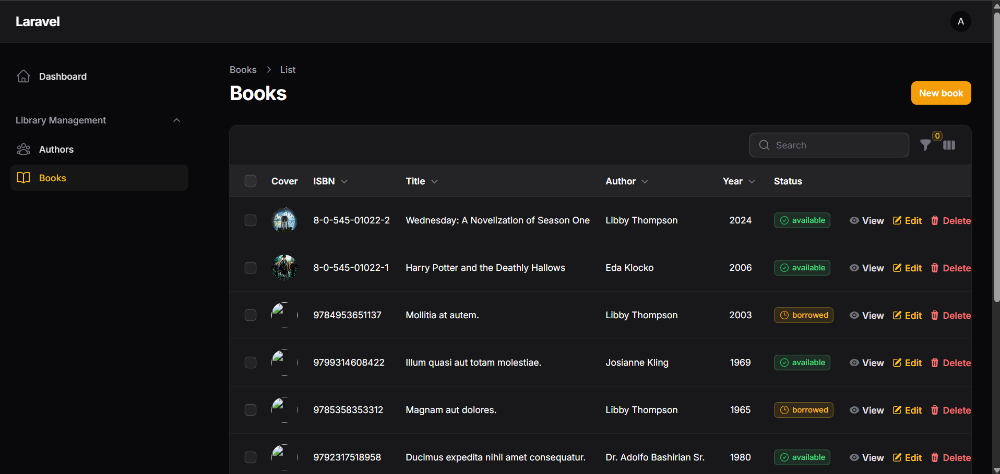
</p>

3. Screenshot form create book
<p align="center">
  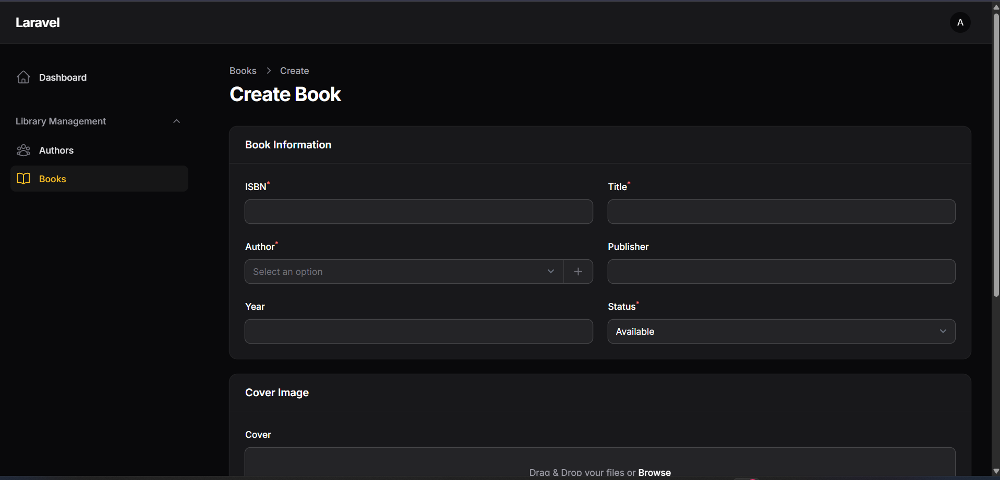
</p>

4. Screenshot hasil pencarian
<p align="center">
  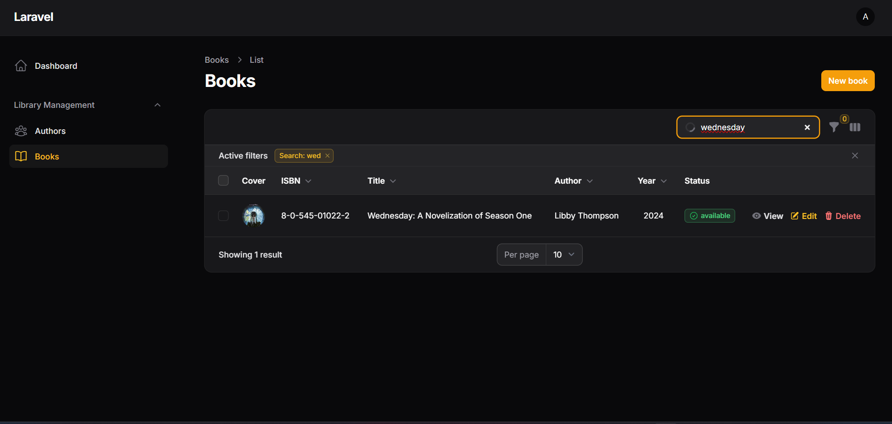
</p>

5. Screenshot filter aktif
<p align="center">
  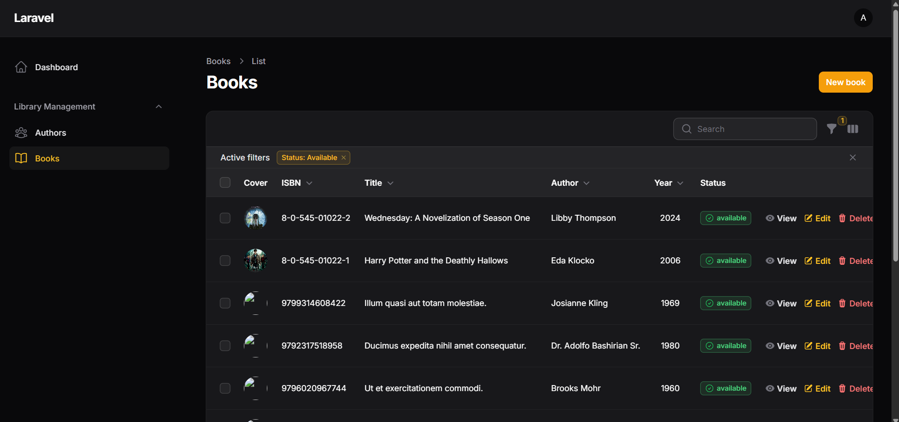
</p>

## Tugas 2: Kustomisasi dan Pengembangan (Nilai:40)
1. Tambah Field Description pada Book (10 poin)
<p align="center">
  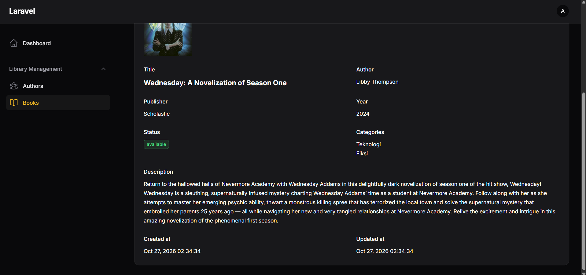
</p>

2. Implementasi Role-Based Access (15 poin)
Admin
<p align="center">
  
</p>
<p align="center">
  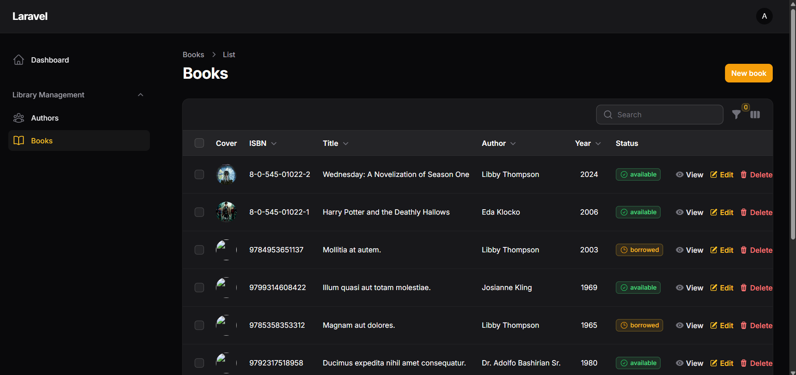
</p>
Staff
<p align="center">
  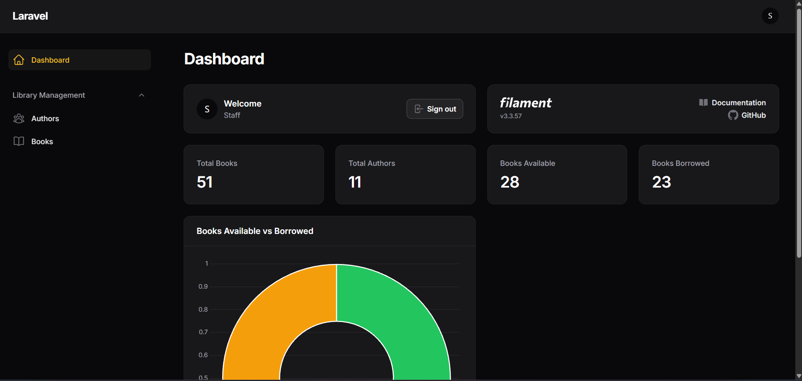
</p>
<p align="center">
  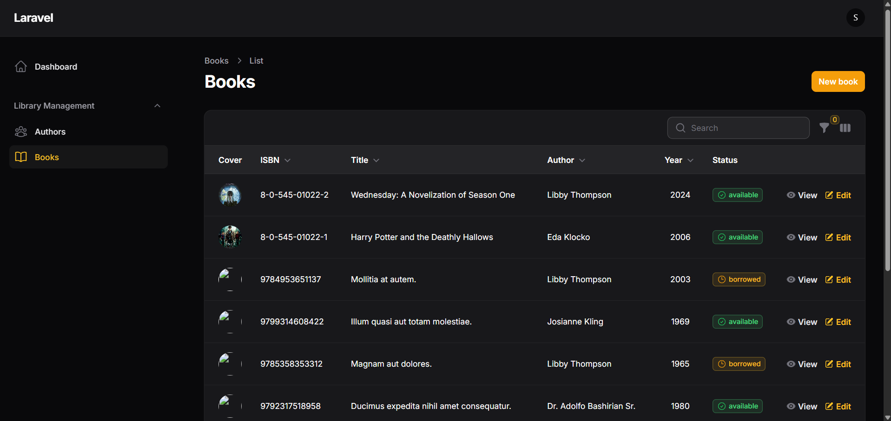
</p>
Viewer
<p align="center">
  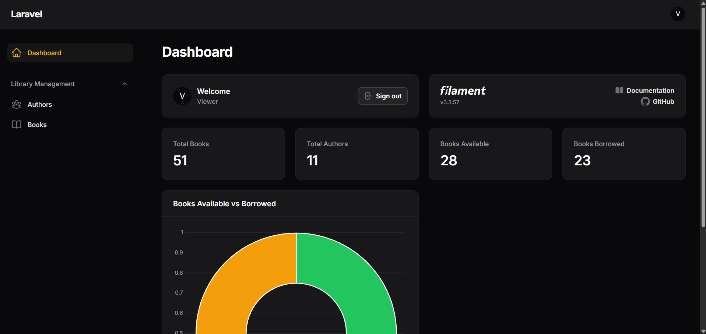
</p>
<p align="center">
  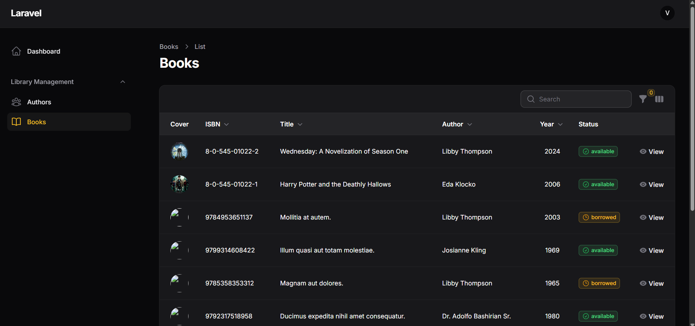
</p>

3. Tambah Widget Dashboard (10 poin)
<p align="center">
  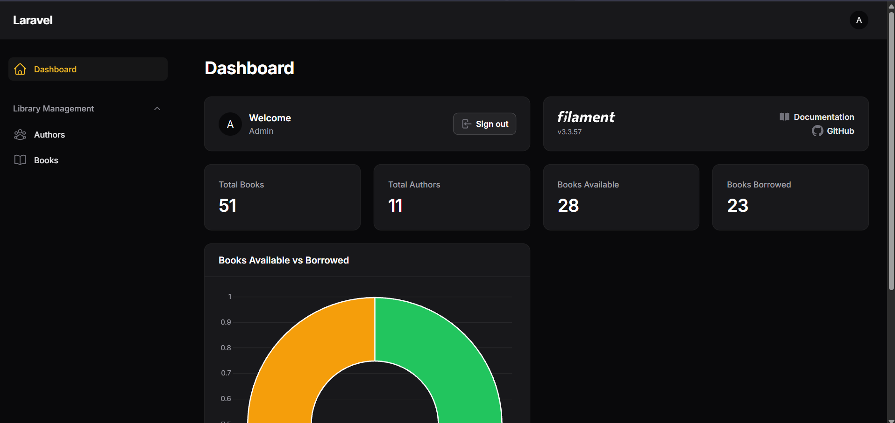
</p>

4. Tambah Kategori Buku (5 poin)
<p align="center">
  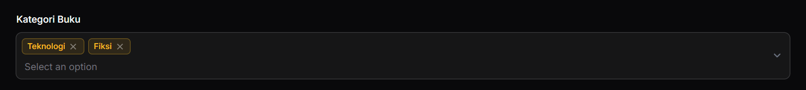
</p>

## Tugas 3
1. Penjelasan Arsitektur (7 poin)
#### 1.1 ERD
<p align="center">
  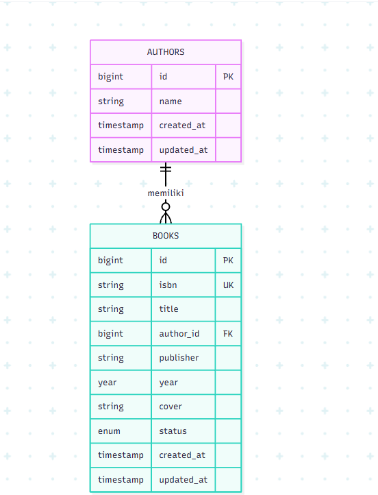
</p>

Keterangan:
- `PK` (*Primary Key*) adalah identitas unik setiap record.
- `FK` (*Foreign Key*) menghubungkan record buku dengan penulisnya.
- `UK` (*Unique Key*) memastikan ISBN tidak memiliki nilai duplikat.

#### 1.2 Relasi Antar Tabel
Relasi antara `authors` dan `books` adalah **one-to-many** (satu ke banyak). Artinya, satu penulis dapat memiliki banyak buku, sedangkan satu buku hanya terhubung dengan satu penulis.

Relasi tersebut diterapkan menggunakan Eloquent ORM:
- Pada model `Author`, method `books()` menggunakan `hasMany(Book::class)`.
- Pada model `Book`, method `author()` menggunakan `belongsTo(Author::class)`.
- Kolom `books.author_id` menjadi foreign key yang mengacu pada `authors.id`.
- Penggunaan `onDelete('cascade')` pada foreign key membuat data buku terkait ikut terhapus ketika data penulis dihapus.

Dengan relasi ini, aplikasi dapat menampilkan daftar buku milik seorang penulis maupun mengetahui penulis dari suatu buku tanpa mengelola hubungan data secara manual.

#### 1.3 Flow Aplikasi
<p align="center">
  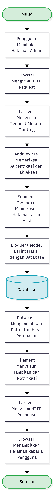
</p>
Penjelasan alur:
1. Pengguna membuka admin panel atau melakukan aksi seperti menambah, mengubah, mencari, dan menghapus buku.
2. Browser mengirimkan HTTP request ke aplikasi Laravel.
3. Laravel mencocokkan request dengan routing dan menjalankan middleware yang diperlukan, termasuk pemeriksaan autentikasi.
4. Filament Resource menangani halaman dan aksi berdasarkan konfigurasi form, table, serta action yang dibuat.
5. Eloquent Model menjalankan operasi terhadap database, misalnya mengambil data buku, menyimpan data baru, memperbarui, atau menghapus record.
6. Database mengembalikan data atau status operasi kepada aplikasi.
7. Filament menyiapkan tampilan, hasil tabel, validasi, atau notifikasi.
8. Laravel mengirimkan response sehingga browser dapat menampilkan hasilnya kepada pengguna.

2. Perbandingan dengan Pendekatan Tradisional (7 poin)
Pembuatan CRUD dengan Filament dan pembuatan CRUD secara manual sama-sama dapat digunakan untuk mengelola data. Perbedaannya terletak pada cara membangun antarmuka dan jumlah komponen yang perlu disiapkan oleh developer.

| Aspek | Menggunakan Filament | Cara Manual dengan Laravel |
|---|---|---|
| Pembuatan form | Form dibuat melalui deklarasi komponen seperti `TextInput`, `Select`, dan `FileUpload`. | Developer membuat tampilan form sendiri menggunakan Blade/HTML dan menangani input. |
| Tabel data | Table, kolom, pencarian, sorting, dan filter disediakan melalui komponen Filament. | Developer membuat halaman tabel dan logika pencarian/filter sendiri. |
| Validasi | Banyak aturan validasi dapat didefinisikan langsung pada komponen form. | Aturan validasi umumnya ditulis pada controller atau Form Request. |
| Operasi CRUD | Resource dan action membantu menyediakan operasi CRUD. | Developer membuat route, controller, view, dan proses CRUD secara terpisah. |
| Kustomisasi tampilan | Mengikuti pola komponen dan struktur Filament; dapat dikustomisasi sesuai kemampuan framework. | Lebih bebas karena tampilan dan interaksi dibangun sendiri. |
| Waktu pengembangan | Umumnya lebih cepat untuk aplikasi admin yang berorientasi CRUD. | Umumnya membutuhkan waktu lebih banyak karena komponen dibuat satu per satu. |
| Pemeliharaan | Struktur Resource membantu menyeragamkan halaman pengelolaan data. | Struktur dapat sangat fleksibel, tetapi konsistensi perlu dijaga oleh developer. |

#### 2.1 Kelebihan dan Kekurangan
**Filament**

Kelebihan:
- Mempercepat pembuatan admin panel dan fitur CRUD.
- Menyediakan komponen form, tabel, pencarian, filter, action, dan notifikasi.
- Mengurangi kode berulang (*boilerplate code*).
- Terintegrasi dengan Laravel, Livewire, dan ekosistem pendukungnya.

Kekurangan:
- Developer perlu mempelajari pola dan API komponen Filament.
- Tampilan mengikuti struktur dan pola Filament sehingga kebutuhan UI yang sangat khusus mungkin memerlukan penyesuaian tambahan.
- Kurang tepat jika seluruh halaman publik membutuhkan desain dan interaksi yang sangat berbeda dari pola admin panel.

**Pendekatan Manual dengan Laravel**

Kelebihan:
- Kontrol lebih luas terhadap struktur halaman, tampilan, dan alur interaksi.
- Dapat disesuaikan untuk kebutuhan antarmuka yang sangat spesifik.
- Developer dapat menentukan sendiri komponen dan pola implementasi.

Kekurangan:
- Membutuhkan lebih banyak kode untuk route, controller, view, form, tabel, validasi, dan fitur pendukung.
- Waktu pengembangan CRUD sederhana dapat lebih lama.
- Konsistensi dan pemeliharaan komponen perlu diatur sendiri.

#### 2.2 Kapan Sebaiknya Menggunakan Filament atau Pendekatan Manual?

Filament sebaiknya digunakan ketika aplikasi membutuhkan admin panel, CMS, dashboard internal, aplikasi backoffice, atau sistem yang sebagian besar fiturnya berupa pengelolaan data (CRUD). Contohnya adalah aplikasi Manajemen Buku pada praktikum ini karena admin perlu mengelola data penulis dan buku, melakukan pencarian, filtering, serta upload sampul.

Pendekatan manual lebih sesuai ketika aplikasi membutuhkan halaman publik dengan desain dan interaksi yang sangat khusus, alur antarmuka yang tidak mengikuti pola admin panel, atau kontrol penuh terhadap setiap bagian UI. Keduanya juga dapat dikombinasikan: Filament digunakan untuk panel administrasi, sedangkan halaman publik dibuat menggunakan Blade, Livewire, atau pendekatan Laravel lain sesuai kebutuhan.

3. Refleksi Pembelajaran (6 poin)
#### 3.1 Hal yang Dipelajari

Melalui praktikum ini, beberapa hal yang dipelajari adalah:
- Memahami penerapan konsep MVC dan penggunaan Laravel sebagai framework pengembangan web.
- Membuat migration untuk mendefinisikan struktur tabel database.
- Membuat model Eloquent serta menerapkan relasi one-to-many antara penulis dan buku.
- Menggunakan factory dan seeder untuk menghasilkan data dummy.
- Membuat fitur CRUD melalui Filament Resources.
- Mengatur form, validasi, tabel, pencarian, filter, halaman detail, dan upload gambar.
- Memahami penggunaan Laravel Policies untuk mengatur authorization.

#### 3.2 Kesulitan yang Dihadapi dan Cara Mengatasinya

Bagian ini merupakan contoh refleksi yang perlu disesuaikan dengan pengalaman pengerjaan sebenarnya.

| Kesulitan yang mungkin ditemui | Cara mengatasi |
|---|---|
| Gambar pada deskripsi book tidak muncul. | Memperbaiki `.env` pada bagian APP_URL. |
| Relasi buku dan penulis tidak menampilkan data yang sesuai. | Memeriksa foreign key `author_id`, nama method relasi pada model, serta memastikan data penulis tersedia. |

#### 3.3 Rencana Pengembangan Aplikasi Selanjutnya

Beberapa pengembangan yang dapat dilakukan setelah praktikum adalah:
1. Mengembangkan fitur laporan dan export data agar pengelolaan koleksi buku lebih mudah.
2. Menambahkan banyak fitur lainnya seperti menambahkan data diri author dan beberapa judul bukunya.

## Kesimpulan

Melalui praktikum ini, mahasiswa mempelajari pembuatan aplikasi
manajemen buku menggunakan Laravel dan Filament 3.x. Praktikum mencakup
pembuatan database dan relasi one-to-many, penggunaan factory dan
seeder, implementasi CRUD melalui Filament Resources, upload gambar,
pencarian dan filtering, serta authorization menggunakan Policies.
Filament membantu mempercepat pembuatan admin panel sehingga
pengembangan dapat lebih berfokus pada kebutuhan dan logika aplikasi.

## Referensi

-   [Laravel Documentation](https://laravel.com/docs)
-   [Filament 3.x Documentation](https://filamentphp.com/docs/3.x)
-   [Livewire Documentation](https://livewire.laravel.com/docs)

------------------------------------------------------------------------

**Mata Kuliah:** Pemrograman Berbasis Web\
**Modul:** Membangun Aplikasi Manajemen Buku dengan Laravel & Filament
3.x\
**Praktikum:** 6
